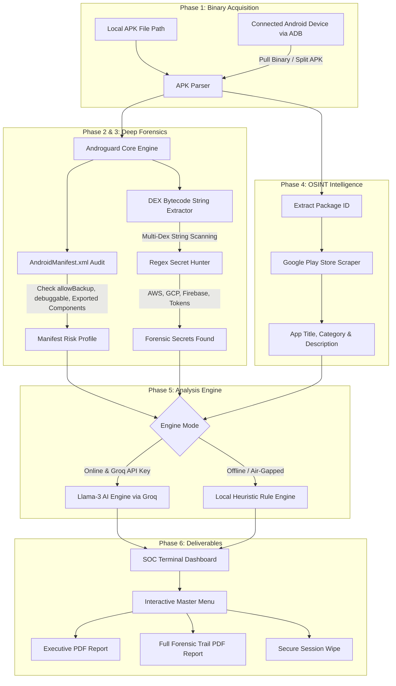

# 🛡️ Android Auditor: AI-Powered APK Security Analyzer

<p align="center">
  
  
  
  
  
  
</p>

---

## 📌 Executive Overview

**Android Auditor** is an enterprise-grade automated **Static Application Security Testing (SAST)** and **Mobile Application Security Testing (MAST)** tool tailored for Android binaries (`.apk`). 

Combining deep binary bytecode reverse engineering with **context-aware Generative AI (Llama-3 via Groq)** and **OSINT metadata scraping (Google Play Store)**, Android Auditor uncovers hidden malicious behavior, over-privileged capabilities, hardcoded cloud credentials, and manifest vulnerabilities that conventional static scanners miss.

---

## 🚨 The Problem in Mobile Security

1. **Malicious Intent Masked Behind Innocent Packaging:** Many malicious or intrusive Android applications masquerade as simple utilities (e.g., flashlights, calculators, wallpapers, casual games). Behind the scenes, they request dangerous capabilities such as `READ_SMS`, `RECORD_AUDIO`, `ACCESS_FINE_LOCATION`, and `READ_CONTACTS`.
2. **Context-Blind Static Analyzers:** Traditional SAST tools only inspect code and manifest definitions in isolation. They lack the real-world contextual reasoning needed to answer: *"Does a calculator application genuinely require microphone and SMS permissions?"*
3. **Leaked Cloud Secrets & API Keys:** Compiled Dalvik Executable (`DEX`) files often contain unencrypted production keys (AWS access keys, Google Cloud API keys, Firebase real-time database URLs, private corporate subnet IPs, authorization tokens).
4. **Tedious Manual Device Auditing:** Security auditors testing physical Android hardware usually spend hours running manual Android Debug Bridge (`adb`) commands to find package names, locate split APK directories, and pull binaries to a workstation.

---

## 💡 The Solution Provided by Android Auditor

Android Auditor provides a fully automated, end-to-end security pipeline:

- **Context-Aware Intent vs. Permission Audit:** It correlates the application's declared Google Play Store description, title, and category against its requested permissions to spot suspicious permission discrepancies.
- **OWASP Mobile Top 10 Mapping:** Automatically maps detected vulnerabilities to OWASP Mobile categories (such as *M1: Improper Platform Usage*, *M2: Insecure Data Storage*, *M5: Insufficient Cryptography*).
- **Dalvik Bytecode Secrets Hunter:** Recursively decompiles string pools across all `.dex` files in the package to detect leaked secrets with high-fidelity regular expressions.
- **Direct Physical Device Extraction (ADB):** Connects directly to USB or wireless Android devices, lists installed third-party apps, resolves split APKs (`base.apk`), and pulls them to the auditor in one click.
- **Dual Engine Architecture:**
  - **AI Mode:** Leverages ultra-fast Llama-3 inference via the Groq Cloud API for deep contextual risk evaluation and developer remediation guides.
  - **Air-Gapped Heuristic Mode:** Built-in rule-based internal logic engine that evaluates safety even without an internet connection or API keys.
- **Publication-Ready PDF Reports:** Compiles findings into professional, CISO-grade VAPT reports using ReportLab with tables, severity badges, and mitigation strategies.
- **SOC-Inspired Terminal Experience:** Features a high-contrast Phosphor Green & Neon Red cyberpunk CLI with interactive menus and session control.

---

## 🏗️ Architecture & How It Works



### Detailed Pipeline Stages

| Stage | Name | Description |
| :---: | :--- | :--- |
| **01** | **Acquisition** | Ingest an APK locally or query an Android device via ADB (`adb shell pm list packages -3`) to extract third-party APKs automatically. |
| **02** | **Manifest Audit** | Parses `AndroidManifest.xml` to evaluate dangerous flags (`android:allowBackup="true"`, `android:debuggable="true"`) and counts exposed activities, services, receivers, and providers. |
| **03** | **DEX Secrets Hunt** | Iterates through all Dalvik Executables (`classes.dex`, `classes2.dex`, etc.), extracts string tables, and matches against regex signatures for leaked cloud secrets. |
| **04** | **OSINT Enrichment** | Queries Google Play Store API via package ID to obtain the public title, category/genre, and full store description. |
| **05** | **Contextual Assessment** | Sends the metadata, manifest risks, and secret signatures to Groq Llama-3 (or the local heuristic engine) to identify permission-to-intent anomalies and compute a **0-10 Risk Score**. |
| **06** | **Report Generation** | Formats an enterprise-grade PDF report (Executive Summary or Full Forensic Trail) complete with severity matrices and remediation steps. |

---

## 🔍 Key Features

### 1. Contextual Permission Misalignment Engine
Malicious applications often declare innocent purposes while requesting privacy-violating permissions. Android Auditor cross-references the app's real-world category against strict category rules:

| Application Category | Flagged High-Risk Permissions |
| :--- | :--- |
| **Calculator** | `RECORD_AUDIO`, `CAMERA`, `READ_SMS`, `ACCESS_FINE_LOCATION` |
| **Flashlight** | `READ_CONTACTS`, `SEND_SMS`, `READ_SMS`, `RECORD_AUDIO` |
| **Casual Game** | `READ_CALL_LOG`, `SEND_SMS`, `READ_SMS`, `PROCESS_OUTGOING_CALLS` |
| **Wallpaper** | `RECORD_AUDIO`, `READ_SMS`, `SEND_SMS`, `READ_CONTACTS` |
| **Utility / Tool** | `SEND_SMS`, `READ_CALL_LOG` |

### 2. High-Fidelity Secrets Scanner
The DEX scanner hunts for credentials hardcoded in compiled binary bytecode:
- **GCP API Keys:** `AIza[0-9A-Za-z\-_]{35}`
- **Firebase Databases:** `https://[a-z0-9.-]+\.firebaseio\.com`
- **AWS Access Keys:** `AKIA[0-9A-Z]{16}`
- **AWS S3 Buckets:** `[a-z0-9.-]+\.s3\.amazonaws\.com`
- **Internal Private IPs:** Private RFC 1918 IPv4 ranges (`10.x.x.x`, `192.168.x.x`, `172.16-31.x.x`)
- **Sensitive Keywords:** Embedded `password`, `secret_key`, and `auth_token` declarations.

### 3. Comprehensive OWASP Mobile Top 10 Mapping
Findings are automatically categorized against the industry-standard OWASP Mobile framework:
- **M1: Improper Platform Usage:** Permission abuse, exported components with intent-filters, debuggable flags.
- **M2: Insecure Data Storage:** Enabled backup (`allowBackup="true"`), plaintext secrets in bytecode.
- **M5: Insufficient Cryptography:** Hardcoded encryption keys and exposed API tokens.
- **M8: Code Tampering:** Debug mode left enabled in production binaries.

### 4. Enterprise PDF Generation
Built with ReportLab, the generated reports include:
- **Header:** Clean dark blue `#1B2631` header styling and metadata summary.
- **Executive Summary:** Overall Risk Score (0-10), Verdict (*Safe*, *Suspicious*, *Malicious*), and top findings.
- **Detailed Findings Table:** Component / Vulnerability, Contextual Risk, OWASP Category, and Remediation Steps.
- **Forensic Secrets Evidence Table:** Secret Type, Evidence Preview, Severity Badge (High, Medium, Low), and Remediation Guide.
- **Tier Selection:** Choose between **Executive Summary** (Top 15 high-risk findings) or **Full Forensic Trail** (All detected entities).

---

## 🛠️ Tech Stack

- **Core Language:** Python 3.9+
- **Bytecode & APK Forensics:** `androguard`
- **AI Engine:** Meta Llama-3 (`llama3-8b-8192`) via `openai` client powered by **Groq Cloud API**
- **PDF Engine:** `reportlab`
- **OSINT Enrichment:** `google-play-scraper`
- **Terminal Styling:** `colorama`, `loguru`
- **Hardware Integration:** Android Debug Bridge (`adb`) via `subprocess`

---

## 🚀 Getting Started

### Prerequisites

1. **Python 3.9 or higher** installed and added to your `PATH`.
2. *(Optional)* **Android SDK Platform-Tools (`adb`)** installed and in `PATH` if auditing connected Android devices.
3. **Groq Cloud API Key** (Free tier available at [console.groq.com](https://console.groq.com/keys)).

### 1. Clone the Repository

```bash
git clone https://github.com/yashwanth-63818/Android-Auditor-AI-Powered-APK-Security-Analyzer-.git
cd Android-Auditor-AI-Powered-APK-Security-Analyzer-
```

### 2. Set Up a Virtual Environment

```bash
# Windows
python -m venv .venv
.venv\Scripts\activate

# Linux / macOS
python3 -m venv .venv
source .venv/bin/activate
```

### 3. Install Dependencies

```bash
pip install -r requirements.txt
```

*(Alternatively, install packages directly)*:
```bash
pip install androguard reportlab openai google-play-scraper python-dotenv colorama loguru
```

### 4. Configure Environment Variables

Create a `.env` file in the root directory:

```env
GROQ_API_KEY=gsk_your_groq_api_key_here
```

*(You can copy from `.env.example`: `cp .env.example .env`)*

---

## 💻 Usage

### Running the Auditor

You can run the auditor directly with Python:

```bash
python main_auditor.py
```

Or on Windows, launch using the bundled batch script:

```bash
startscan.bat
```

> **Pro-Tip:** Add the project directory to your Windows System `PATH` to launch `startscan` from any terminal!

---

### Step-by-Step Interactive Workflow

```
=================================================================
      🛡️         A N D R O I D   A U D I T O R         🛡️
=================================================================

[?] Type 'start' to begin audit or 'end' to exit: start

[?] Select APK Source:
 [1] Manual APK Path (Local)
 [2] Select App from Phone (ADB)
 [B] Back to Main Menu
[?] Source > 1

[?] Enter path to APK: sample.apk

[?] Select Analysis Depth:
 [1] Surface Audit (Manifest Only)
 [2] Deep Static Audit (Manifest + Secrets)
 [3] AI Contextual Audit (Full Logic via Llama-3 Engine)
[?] Analysis Mode > 3

[*] Performing Diagnostic Connection Test...
[*] Engaging Llama-3 AI Engine (Llama-3)... [Connected]
[+] AI Analysis: ONLINE (Llama-3 Engine Active)
[+] Phase 1: Binary Loaded (sample.apk)
[+] Phase 2: Manifest Risk Profile Extracted
[+] Phase 3: Deep Scan Complete (12 Secrets Found)
[+] External Metadata Retrieval: Verified

========================= [ AI-POWERED VAPT REPORT ] =========================
[*] Package:   com.example.app
[+] Risk Score: 7/10
[+] Verdict:    Suspicious
[*] Findings:   Incongruent Camera/SMS permissions for utility category
[*] Forensic Scan: 12 hardcoded entities found.
---------------------------------------------------------------------------

[?] Generate Detailed PDF Report? (y/n): y
[?] Select Report Scope:
 [1] ⚡ Executive Summary (High-Risk/Short)
 [2] 🛡️ Full Forensic Trail (All Findings)
[?] Scope > 1

[+] Audit Report Saved: MAST_Audit_com.example.app_Summary.pdf

========================= [ MASTER CONTROL MENU ] =========================
 [1] Open PDF Report
 [2] Reset (Different App in this session)
 [3] Delete Report & Return to Start
 [4] Exit Auditor
```

---

## 📂 Project Structure

```
Android-Auditor/
├── .env.example               # Template for API keys
├── .gitignore                  # Git ignore rules (.env, .venv, *.apk, etc.)
├── requirements.txt            # Python dependencies
├── README.md                   # Complete project documentation
├── main_auditor.py             # Main entry point, UI, ADB bridge, PDF generator & scanner
├── auditor.py                  # Standalone Groq Llama-3 security auditor module
├── scraper.py                  # Google Play Store OSINT metadata scraper
├── main.py                     # Minimalist standalone APK permission extractor
├── startscan.bat               # Windows quick-launch command script
├── test_gemini.py              # Diagnostic test script for API connectivity
├── check_androguard_4x.py      # Diagnostic helper for Androguard 4.x imports
├── check_androguard_4x_dex.py  # Diagnostic helper for DEX bytecode parsing
├── check_dex_methods.py        # Diagnostic helper for method-level inspections
└── explore_androguard.py       # Helper utility for exploring Androguard APK methods
```

---

## 📊 Sample PDF Reports

The repository includes real sample audit reports generated by Android Auditor:

- `MAST_Audit_com.Dominos_Summary.pdf`
- `MAST_Audit_com.chess_Summary.pdf`
- `MAST_Audit_com.heytap.lab_Summary.pdf`
- `MAST_Audit_com.panda.touch_Summary.pdf`

These demonstrate the enterprise visual styling, table formatting, severity classifications, and remediation steps produced by the tool.

---

## 🛡️ Security & Ethical Disclaimer

> **IMPORTANT:** Android Auditor is developed strictly for **authorized penetration testing**, **security research**, **educational purposes**, and **defensive mobile application auditing**. 
> 
> Testing applications without prior authorization from the application owner or vendor is prohibited. The authors assume no liability for misuse or any damage caused by this utility.

---

## 👤 Author & Acknowledgments

- **Author:** [Yashwanth](https://github.com/yashwanth-63818)
- **Engine:** Meta Llama-3 via [Groq Cloud](https://groq.com)
- **Binary Analysis:** [Androguard](https://github.com/androguard/androguard)
- **PDF Generation:** [ReportLab](https://www.reportlab.com/)

---

<p align="center">
  <b>⭐ Star this repository if you find Android Auditor useful! ⭐</b>
</p>
